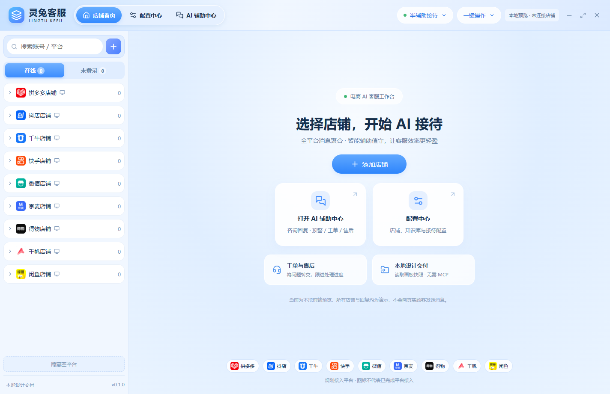

# 灵兔 AI 电商客服 · Electron 客户端



> v0.1.0 本地前端预览。此工程独立于 Figma MCP、ChatGPT Figma 连接器；**没有接入电商平台，也没有发送真实消息的能力**。

## 已有功能

Electron + React + TypeScript + Vite；店铺首页、公共顶部栏/侧栏、配置导航、看板空状态、本地演示店铺管理、进店欢迎语编辑/保存/恢复、离开草稿确认、Figma 设计快照导入（只读）。另外建立 UX01–UX32 路由索引；大部分业务页目前仍为待实现占位页面。

## 本地运行（Windows）

要求 Node.js 22.12+。

```powershell
npm install
npm run build
npm start
```

也可直接双击 `start-preview.cmd`（首次需要安装依赖）。开发热更新用 `npm run dev`。

如果 Electron npm 包存在但 `node_modules/electron/dist/electron.exe` 缺失，可以运行：

```powershell
$env:ELECTRON_MIRROR="https://npmmirror.com/mirrors/electron/"
node .\node_modules\electron\install.js
```

## 验证

```powershell
npm run typecheck
npm test
npm run build
```

端到端测试默认使用 Playwright 自带 Chromium；如未安装，可以在本机临时指定 Chrome：

```powershell
$env:PLAYWRIGHT_CHROMIUM_EXECUTABLE="C:\Program Files\Google\Chrome\Application\chrome.exe"
npm run test:e2e
```

## Figma 不占 MCP 额度的交付流程

1. 首次安装需要在 Figma 桌面端 **Plugins → Development → New Plugin...** 创建一个空白开发插件，让 Figma 分配真实插件 ID。不要复用 NGR 锻造台的 ID。将生成的 ID 填入 `plugins/figma-local-export/manifest.json` 的 `id` 字段，然后在 **Plugins → Development → Import new plugin from manifest...** 选择该文件。后续更新代码无需重复申请 ID。
2. 运行「灵兔 · 本地设计交付」，选中正式画板，点击导出，并保存 `lingtu-design-*.json`。可以拆批次导出 1–20 个节点，不建议超过 20 MB。
3. 在客户端「本地设计交付」页导入 JSON，预览画板与节点数据；或使用 `npm run design:import -- "路径\快照.json"` 将画板结构和 PNG 预览保存到 `design/snapshots/`。
4. 按 `docs/figma-map.json` 为 UX 编号建立本地设计节点 ID，逐个实现 React 页面和交互，复用顶部栏/侧栏，不直接使用截图充当交互界面。
5. 图片素材、图标 SVG 要从 Figma 另行导出；JSON 中的 PNG 是用于对比的预览图。

这个插件为**本地只读导出**，不调用云端 API、不需要 Figma MCP 或 ChatGPT 连接器额度；但仍需能正常打开 Figma 文件。它不具备批量修改 Figma 画板、双向实时同步能力。原始 `.fig` 文件不能直接导入本客户端。

## 设计与 UX

- 设计关联：`docs/figma-map.json`（32 个 UX 号；尚无正式节点 ID）
- 产品功能定义：`docs/IMPLEMENTATION.md`
- 平台示意图标：`public/assets`（来源于已有离线 HTML 前端原型）
- 历史参考：本机下载目录 `AI客服-可编辑图层.fig`；不是已解析的工程数据


## 视觉开发准入标准

目前首页及部分配置页只是可运行交互原型，**尚未按真实 Figma 可编辑画板完成视觉还原**。后续开发必须先导入对应 Frame 的 JSON_REST_V1 图层树、组件/样式引用及 Node ID，再实现 React 页面。PNG 只作视觉对照，不得用截图替代图层，也不得依据截图或 UX 文字猜测最终布局。UX20–UX23、UX25 等未导入正式画板的页面保持待实现。

## 安全边界

仅演示本地数据；没有联网登录店铺/真实 AI 回复。Electron 的 Renderer 关闭 Node 集成，启用 contextIsolation 和 sandbox；preload 只暴露允许的 IPC 方法。店铺 Token、客户信息、密钥及设计原始文件不要提交到 Git。

## 许可证与商业授权

本项目原创代码及随附项目文档采用 **[GNU AGPL v3 only（AGPL-3.0-only）](LICENSE)**。分发及修改版本的网络服务须按许可证履行相应的版权保留、同许可及对应源代码提供义务。

**遵守 AGPL 的商业使用无需另购商业授权。** 需要不同于 AGPL 条件的闭源交付、指定 SaaS、OEM 或其他商业权利时，可向有权授权的项目权利人申请单独许可；以双方明确签署并生效的授权订单为准。

- [完整开源许可证](LICENSE)
- [许可适用范围与使用说明](LICENSING.md)
- [商业授权协议框架（须另行签署）](COMMERCIAL_LICENSE.md)
- [贡献与再许可规则](CONTRIBUTING.md)
- [第三方内容与权利说明](THIRD_PARTY_NOTICES.md)

第三方依赖、素材和商标继续适用各自条款，商业协议不豁免其义务。商业授权意向可在[本仓库 Issues](https://github.com/907609732/LTTLT-AI-Customer-Service/issues) 中提出。
