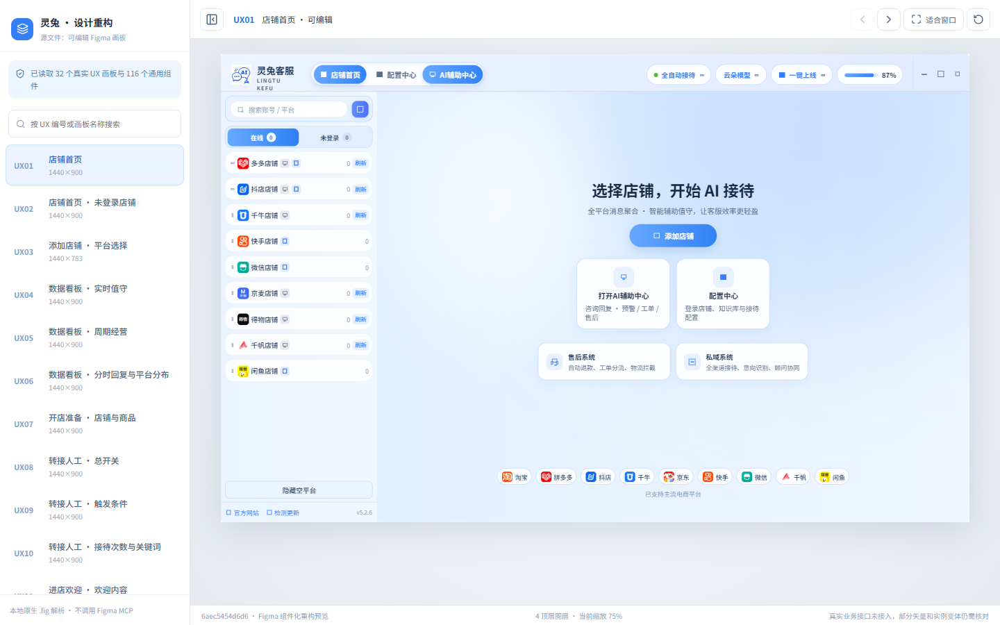

# 灵兔 AI 电商客服 — Figma 可编辑画板重构

本仓库已停止使用早期基于参考图/旧 HTML 的页面实现。新前端的视觉数据只从用户自己的 **Figma 原生可编辑 `.fig` 文件**离线提取，React 组件复用原始 Figma Symbol/Instance 层级。



> 当前是 **v0.2.0 开发预览**。32 个 UX 画板能够在 Electron 中加载和浏览，部分画板导航可点击；真实平台授权、会话发送、订单操作和 AI 客服业务接口尚未连接。不能视作商业可用客户端，也不能宣称所有页面像素还原验收完成。

## 设计输入

源文件：本机 `Downloads/AI客服-可编辑图层.fig`（用户持有，未上传 Git）。

离线解析结果：
- 3,351 个原生图层节点；496 个 Frame；
- 146 个 Figma Symbol 定义，其中 30 个是画板根组件，116 个为其余可复用组件；
- 907 个组件实例；
- 映射到 UX01–UX32 的 32 个可编辑画板；
- 导出 149 个被可编辑画板与其组件引用的原始图片资源。

**无需 Figma MCP、Figma REST API 或 ChatGPT Figma 连接器调用。** 解析器使用 [openfig-core](https://github.com/OpenFig-org/openfig-core) 读取本机 `.fig` / `fig-kiwi` 文件。注意它是社区解析库，格式兼容性不保证永久稳定。

页面有两个 Canvas：`原软件`（图片参考）和 `我们的设计方案`（可编辑图层，ID `2:129`）；**只使用后一者作为视觉依据**。

## 安装和运行（Windows）

要求 Node.js 22.12+：

```powershell
npm ci
npm run build
npm start
```

开发热更新：

```powershell
npm run dev
```

### 重新从 Figma 可编辑源文件同步（不消耗 MCP 额度）

先在 Figma 中将最新设计另存或导出为本地 `.fig` 文件，然后：

```powershell
npm run design:decode -- "C:\Users\90760\Downloads\AI客服-可编辑图层.fig"
npm run design:prepare
npm run build
```

命令会重新解析每个 UX 原生可编辑节点、组件/样式、文字尺寸和资源。`design/snapshots/<hash>/` 是完整的本地私有数据，默认不提交 Git；`src/design/generated` 是用于前端开发的结构化组件和页面数据。新设计文件更新后，仍须进行视觉及功能验收，不代表代码可以自动理解所有交互。

## 项目结构

```text
electron/                 安全 Electron 主进程 / 受控 IPC
src/
  App.tsx                 全新 UX01–UX32 设计画板浏览器
  design/
    actions.ts            已验证的部分画板点击与导航映射
    FigmaCanvas.tsx       组件实例复用 / 原生图层 React 渲染
    style.ts              从 Figma 节点转换颜色、字体、边框、渐变、模糊
    generated/
      screens/UX01.json…  32 份真实可编辑画板结构
      components.json     116 个 Symbol 定义
      assets.json         原生资源 hash 映射
public/figma-assets/      149 个当前画板引用的本地图片
docs/figma-map.json       UX 页面、真实 Figma Node ID、文件 SHA 映射
scripts/decode-fig.mjs    读取 .fig / fig-kiwi，提取原生图层与组件
scripts/prepare-design.mjs 生成运行时层级与图片资源
```

## 测试

```powershell
npm run typecheck
npm test
npm run build
$env:PLAYWRIGHT_CHROMIUM_EXECUTABLE="C:\Program Files\Google\Chrome\Application\chrome.exe"
npm run test:e2e
npm run test:electron
npm run dist:win
npm run test:packaged
```

### 当前还没完成的工作

当前设计浏览器使用 React 布局节点渲染器，**不是截图贴图**。Figma 的字号、颜色、位置、渐变、图片、组件层级已转成网页属性；但是复杂矢量轮廓、嵌套组件覆盖、全部 Auto Layout 响应规则以及真实交互仍需逐页还原与测试。顶栏、侧栏、按钮、弹窗等通用组件已经在可编辑资源中索引，下一步将提炼为业务 React 组件。

早期视觉组件代码已从此重构分支删除，旧版本仍可从 Git 历史及 `backup/pre-figma-rebuild-20261107` 本地分支恢复。原始 `.fig` 文件、Electron 安全框架、项目和 Git 历史没有删除。

## 安全

该应用当前只能浏览本地设计和做有限路由演示。不要把真实店铺 Token、顾客消息、订单数据、API 密钥或完整 `.fig` 文件提交到 GitHub。未开启任何真实客服自动回复或订单处理。

## 许可证与商业授权

本项目原创代码及随附项目文档采用 **[GNU AGPL v3 only（AGPL-3.0-only）](LICENSE)**。分发及修改版本的网络服务须按许可证履行相应的版权保留、同许可及对应源代码提供义务。

**遵守 AGPL 的商业使用无需另购商业授权。** 需要不同于 AGPL 条件的闭源交付、指定 SaaS、OEM 或其他商业权利时，可向有权授权的项目权利人申请单独许可；以双方明确签署并生效的授权订单为准。

- [完整开源许可证](LICENSE)
- [许可适用范围与使用说明](LICENSING.md)
- [商业授权协议框架（须另行签署）](COMMERCIAL_LICENSE.md)
- [贡献与再许可规则](CONTRIBUTING.md)
- [第三方内容与权利说明](THIRD_PARTY_NOTICES.md)

第三方依赖、素材和商标继续适用各自条款，商业协议不豁免其义务。商业授权意向可在[本仓库 Issues](https://github.com/907609732/LTTLT-AI-Customer-Service/issues) 中提出。
